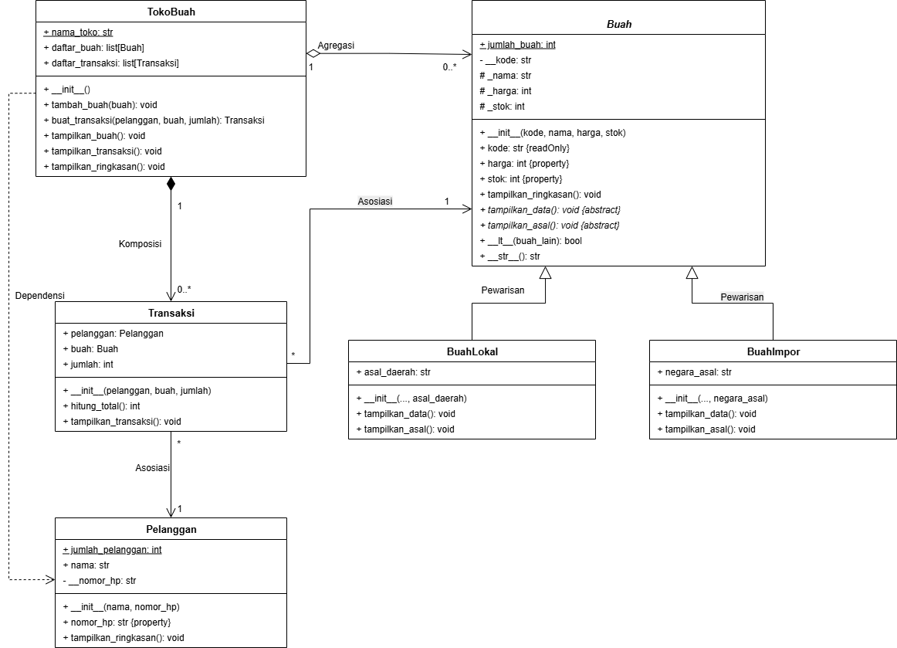
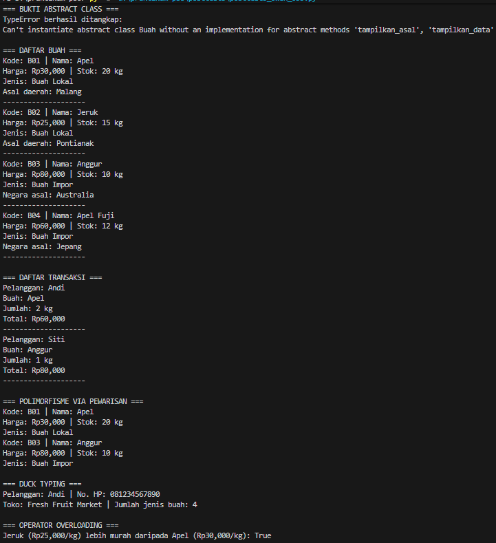

# Sistem Manajemen Toko Buah

Program Python ini menerapkan konsep Object-Oriented Programming (OOP): class dan object, encapsulation, inheritance, abstraction, polymorphism, duck typing, operator overloading, serta relasi antarobjek.

## Class Diagram UML



Keterangan relasi:
- **Inheritance**: `BuahLokal` dan `BuahImpor` mewarisi `Buah`.
- **Agregasi**: `TokoBuah` menyimpan objek buah yang dapat dibuat secara terpisah dari toko.
- **Komposisi**: `TokoBuah` membuat dan mengelola objek `Transaksi` dalam daftar transaksinya.
- **Asosiasi**: `Transaksi` berhubungan dengan objek `Pelanggan` dan `Buah`.

## Penerapan konsep OOP

### 1. Abstract Base Class
- `Buah` mewarisi dari `ABC`.
- `tampilkan_data()` dan `tampilkan_asal()` merupakan abstract method.
- `BuahLokal` dan `BuahImpor` mengimplementasikan kedua abstract method.
- `tampilkan_ringkasan()` merupakan method konkret yang diwariskan.
- Program mencoba membuat objek `Buah`; Python menghasilkan `TypeError` karena abstract method belum diimplementasikan.

### 2. Inheritance
`BuahLokal` dan `BuahImpor` menggunakan `super().__init__(kode, nama, harga, stok)` untuk memanggil konstruktor `Buah`. Masing-masing subclass memiliki atribut unik, yaitu `asal_daerah` dan `negara_asal`.

### 3. Polimorfisme via pewarisan
Kedua subclass meng-override `tampilkan_data()`. Pemanggilan method dilakukan melalui satu loop yang berisi objek `BuahLokal` dan `BuahImpor`, tanpa memeriksa tipe objek menggunakan `type()` atau rantai `if/elif`.

### 4. Duck typing
Kelas `Pelanggan` dan `TokoBuah` tidak memiliki hubungan inheritance, tetapi keduanya mempunyai method `tampilkan_ringkasan()`. Fungsi `cetak_ringkasan(objek)` dapat memanggil method tersebut pada kedua objek.

### 5. Operator overloading
Kelas `Buah` mengimplementasikan `__lt__()` agar dua objek buah dapat dibandingkan menggunakan operator `<` berdasarkan harga.

### 6. Encapsulation
- `__kode` pada `Buah` dan `__nomor_hp` pada `Pelanggan` adalah atribut private.
- `_nama`, `_harga`, dan `_stok` menggunakan konvensi protected.
- `harga`, `stok`, dan `nomor_hp` disediakan melalui property; harga, stok, dan nomor HP divalidasi saat diubah.

## Bukti abstraksi
Di bagian `=== BUKTI ABSTRACT CLASS ===`, program mencoba menginstansiasi `Buah`. Program menangkap `TypeError` dan menampilkan pesan bahwa abstract class tidak dapat dibuat menjadi objek sebelum seluruh abstract method diimplementasikan.

Contoh hasil (pesan dapat sedikit berbeda tergantung versi Python):

```text
=== BUKTI ABSTRACT CLASS ===
TypeError berhasil ditangkap:
Can't instantiate abstract class Buah with abstract methods tampilkan_asal, tampilkan_data
```
## Output Program

